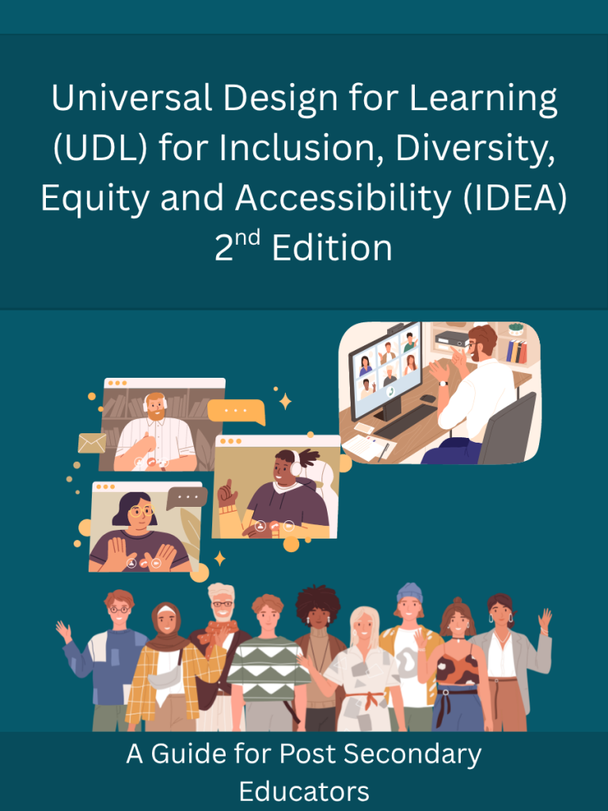

# Universal Design for Learning (UDL) for Inclusion, Diversity, Equity, and Accessibility (IDEA) 2nd Edition

Darla Benton Kearney

[CC BY 4.0](https://creativecommons.org/licenses/by/4.0/ ":class=navpill")

[Start Reading](section-1/about-this-guide.md ":class=button :class=primary")

> [!IMPORTANT]
> **Universal Design for Learning (UDL) for Inclusion, Diversity, Equity, and Accessibility (IDEA) 2nd Edition – Imported from Pressbooks**
>
>
> **Authors:** Darla Benton Kearney | **License:** CC BY 4.0 | **36 pages**
>
> [View original on Pressbooks](https://ecampusontario.pressbooks.pub/universaldesign2/)
>
>

The Universal Design for Learning (UDL) for Inclusion, Diversity, Equity, and Accessibility (IDEA) project was a collaboration between 10 universities and colleges across Ontario to develop a 6-module open educational resource for post-secondary educators.  This 2nd edition open courseware provides educators with an introduction to the UDL 3.0 framework and its application in support of AODA, EDI, and Indigenous pedagogies.

## [Front Matter](section-1/about-this-guide.md) <!-- {docsify-ignore} -->

Accessibility, about, preface, and acknowledgements.

## [Module 1: Introduction and Overview of UDL](section-2/README.md) <!-- {docsify-ignore} -->

## [Module 2: UDL in Post-Secondary & Technology Enabled Learning Environments](section-3/README.md) <!-- {docsify-ignore} -->

## [Module 3: Legislative Requirements Under the AODA and OHRC](section-4/README.md) <!-- {docsify-ignore} -->

## [Module 4: Equity, Diversity, and Inclusion (EDI)](section-5/README.md) <!-- {docsify-ignore} -->

## [Module 5: Indigenous Pedagogies and the Benefits for All Learners in Ontario](section-6/README.md) <!-- {docsify-ignore} -->

## [Module 6: UDL for AODA, EDI and Indigenous Pedagogies in Post-Secondary Learning Environments](section-7/README.md) <!-- {docsify-ignore} -->

## [Glossary](section-8/README.md) <!-- {docsify-ignore} -->

Terms used in this book.

**[Start Reading →](section-1/about-this-guide.md)**

Universal Design for Learning (UDL) for Inclusion, Diversity, Equity, and Accessibility (IDEA) 2nd Edition by Darla Benton Kearney © 2026 (2nd ed) is licensed under <a href="https://creativecommons.org/licenses/by/4.0/">CC BY 4.0</a>.

<!-- Hides the sidebar on this page -->

