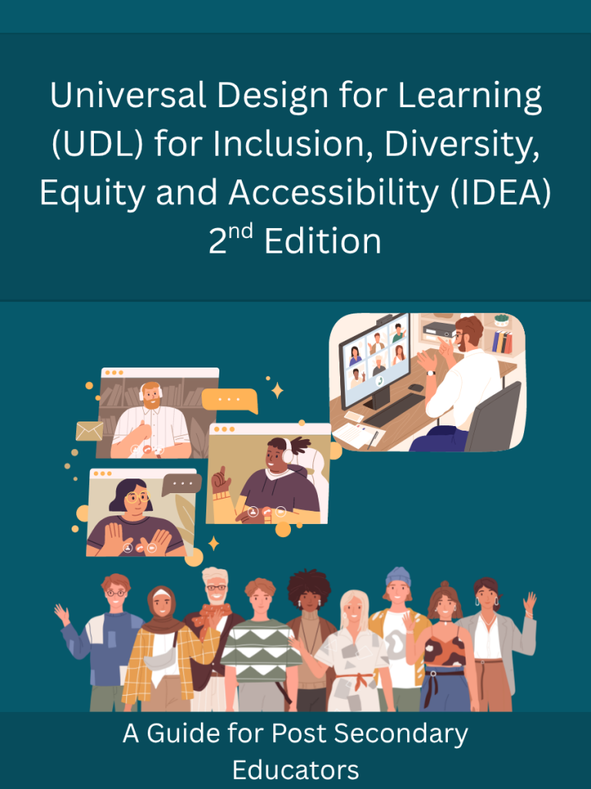

<!-- grav: {"file":"01.universal-design-for-2026/section-list.md","images":["UDLforIDEAcover-1-768x1024.png"]}
title: "Universal Design for Learning (UDL) for Inclusion, Diversity, Equity, and Accessibility (IDEA) 2nd Edition"
menu: "Universal Design for Learning (UDL)"
cover_image: UDLforIDEAcover-1-768x1024.png
cover_image_layout: small
authors: "Darla Benton Kearney"
show_oer_attribution: true
license: "CC BY 4.0"
license_url: "https://creativecommons.org/licenses/by/4.0/"
section_label: Module
show_section_label: false
attribution_text: "Universal Design for Learning (UDL) for Inclusion, Diversity, Equity, and Accessibility (IDEA) 2nd Edition by Darla Benton Kearney © 2026 (2nd ed) is licensed under <a href=\"https://creativecommons.org/licenses/by/4.0/\">CC BY 4.0</a>."
-->

<!-- grav:gen -->

# Universal Design for Learning (UDL) for Inclusion, Diversity, Equity, and Accessibility (IDEA) 2nd Edition

Darla Benton Kearney

[CC BY 4.0](https://creativecommons.org/licenses/by/4.0/ ":class=navpill")

[Start Reading](universal-design-for-2026/section-1/about-this-guide.md ":class=button :class=primary")

<!-- /grav:gen -->

<!-- grav: [announcement title="Universal Design for Learning (UDL) for Inclusion, Diversity, Equity, and Accessibility (IDEA) 2nd Edition — Imported from Pressbooks"] -->
> [!IMPORTANT]
> **Universal Design for Learning (UDL) for Inclusion, Diversity, Equity, and Accessibility (IDEA) 2nd Edition — Imported from Pressbooks**
>
>
> **Authors:** Darla Benton Kearney | **License:** CC BY 4.0 | **36 pages**
>
> [View original on Pressbooks](https://ecampusontario.pressbooks.pub/universaldesign2/)
>
> *[Grav Open Publishing Space](https://www.hibbittsdesign.org/grav-open-publishing-space.html) supports embedded video, audio, and H5P activities. Video, audio, and H5P content in this converted book may appear as links rather than embedded content.*
>

The Universal Design for Learning (UDL) for Inclusion, Diversity, Equity, and Accessibility (IDEA) project was a collaboration between 10 universities and colleges across Ontario to develop a 6-module open educational resource for post-secondary educators.  This 2nd edition open courseware provides educators with an introduction to the UDL 3.0 framework and its application in support of AODA, EDI, and Indigenous pedagogies.

<!-- grav:gen -->
- **[Front Matter](universal-design-for-2026/section-1/about-this-guide.md)**  
  Accessibility, about, preface, and acknowledgements.

- **[Module 1: Introduction and Overview of UDL](universal-design-for-2026/section-2/11-origins-of-udl.md)**

- **[Module 2: UDL in Post-Secondary & Technology Enabled Learning Environments](universal-design-for-2026/section-3/21-applying-udl-in-the-design-phase.md)**

- **[Module 3: Legislative Requirements Under the AODA and OHRC](universal-design-for-2026/section-4/31-principles-of-accessible-legislation.md)**

- **[Module 4: Equity, Diversity, and Inclusion (EDI)](universal-design-for-2026/section-5/41-what-is-edi.md)**

- **[Module 5: Indigenous Pedagogies and the Benefits for All Learners in Ontario](universal-design-for-2026/section-6/51-the-importance-of-place-and-space.md)**

- **[Module 6: UDL for AODA, EDI and Indigenous Pedagogies in Post-Secondary Learning Environments](universal-design-for-2026/section-7/61-review-of-universal-design-for-learning.md)**

<!-- /grav:gen -->

<!-- grav:gen -->
Universal Design for Learning (UDL) for Inclusion, Diversity, Equity, and Accessibility (IDEA) 2nd Edition by Darla Benton Kearney © 2026 (2nd ed) is licensed under <a href="https://creativecommons.org/licenses/by/4.0/">CC BY 4.0</a>.

<!-- Hides the sidebar on this page -->

<!-- /grav:gen -->
